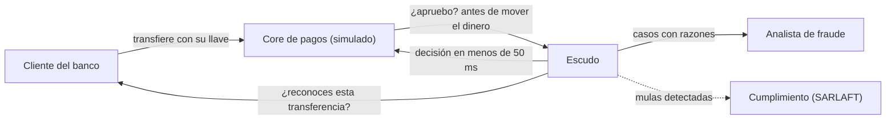
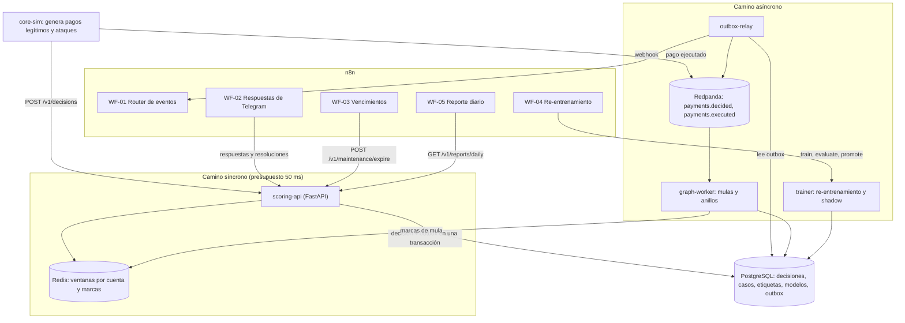
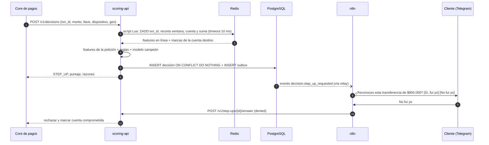
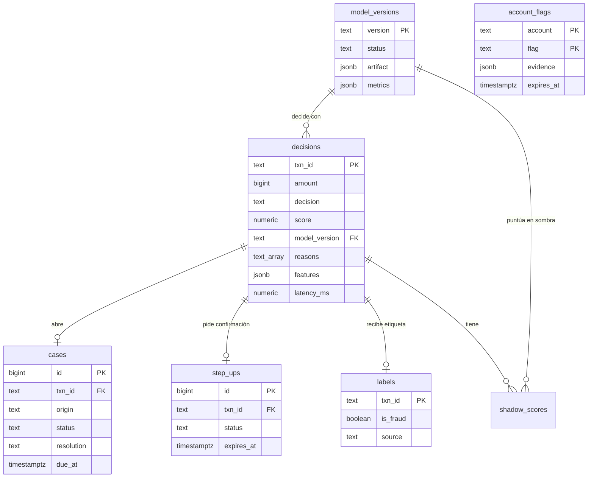

# Propuesta 01 · **Escudo** — Detección de fraude en tiempo real para pagos inmediatos

| Nivel | Duración estimada | Arquitectura | Para impresionar a |
|---|---|---|---|
| Avanzado (**proyecto insignia**) | 7 semanas a ~10 h/semana | Camino síncrono de decisión + camino asíncrono por eventos, dominio hexagonal portable | Backend / plataforma · Fintech (bancos, billeteras, pasarelas de pago) |

> Documento de diseño original del proyecto. Las decisiones vigentes viven en [`adr/`](adr/).

---

## 1. Resumen ejecutivo

**Contexto real.** Colombia tiene desde octubre de 2025 **Bre-B**, el sistema de pagos inmediatos del
Banco de la República: transferencias gratuitas entre entidades, a cualquier hora, usando *llaves*
(celular, cédula, correo o alfanuméricas). En su primer año la prensa reportó del orden de **116
millones de llaves** registradas. Un pago inmediato es **irrevocable en segundos**: si el fraude no se
detiene *antes* de mover el dinero, ya no se recupera.

**Problema.** Las tomas de cuenta, las estafas por ingeniería social (la víctima misma envía el dinero)
y las redes de cuentas mula escalan con los pagos inmediatos. Un banco necesita decidir en milisegundos,
explicar por qué decidió y no molestar a sus clientes legítimos.

**Solución.** Escudo decide cada transferencia **antes** de ejecutarla (APPROVE, STEP_UP, REVIEW o
DECLINE) en menos de 50 ms, combinando reglas explicables, un modelo calibrado y *features* de ventana
deslizante. En paralelo analiza el grafo de pagos para descubrir redes de mulas. n8n lleva los casos a
los analistas, pide confirmación al cliente ("¿reconoces esta transferencia?") y gobierna la promoción
de modelos con aprobación humana.

**Por qué impresiona.** El entrevistador **lanza el ataque él mismo** desde un enlace público y ve al
sistema detenerlo en vivo, comparado contra "sin protección". Detrás hay decisiones de ingeniería que se
preguntan en entrevistas de fintech: latencia, idempotencia, degradación ante fallos, umbrales por costo
de negocio, sesgo de etiquetas y gobierno de modelos.

---

## 2. Momento demo (guion de 60 segundos)

| Segundo | Lo que pasa en pantalla | Lo que dices |
|---|---|---|
| 0–10 | Dashboard en vivo: transferencias por segundo, mapa de Colombia, contador "dinero protegido". Selector de política en **"Sin protección"** | "Esto es un banco simulado con 1 500 clientes haciendo pagos inmediatos." |
| 10–25 | El entrevistador pulsa **"Lanzar toma de cuenta"** y **"Activar red de mulas"**. El contador de "dinero perdido" sube en rojo | "Así se ve un banco sin defensa: el dinero sale y no vuelve." |
| 25–40 | Cambia a **"Escudo"** y repite el ataque. Las transferencias se marcan en ámbar (STEP_UP) y rojo (REVIEW/DECLINE); aparece el anillo de mulas en el grafo | "Ahora cada pago se decide antes de moverse, en microsegundos dentro del proceso." |
| 40–50 | Clic en una transferencia bloqueada: razones (`regla:toma-de-cuenta`, `modelo:new_payee`, `modelo:amount_log`) | "Cada decisión es explicable: un banco tiene que justificarla ante el cliente y el regulador." |
| 50–60 | Tabla: dinero detenido 97,6 % vs. 44 % solo con reglas, y bloqueos legítimos por cada 1 000 | "Y lo importante: cuánto fraude detengo **y cuánto molesto** a los clientes buenos." |

Esta demo corre **gratis en Netlify**: el motor de decisión es el mismo paquete Python del backend,
ejecutándose en el navegador con Pyodide (ver §8).

---

## 3. Objetivos de aprendizaje

| Eje | Qué aprendes concretamente |
|---|---|
| Python | Estructuras O(1) amortizado (`deque`, `Counter`), `IntEnum` como orden de severidad, dominio sin dependencias (corre en CPython y en Pyodide), FastAPI con presupuesto de latencia, consumidores de Kafka |
| n8n | Router de eventos por webhook, Telegram con botones (*callback queries*), flujos con humano en el circuito, aprobaciones de despliegue de modelos, reportes programados |
| Arquitectura | Camino síncrono vs. asíncrono, *feature store* en línea, idempotencia por construcción, *transactional outbox*, degradación elegante (*fail-open* / *fail-closed*), *shadow mode* y *champion/challenger* |
| Lógica | Ventanas deslizantes, haversine y viaje imposible, motor de reglas sin `eval`, sigmoide numéricamente estable, umbral óptimo por costo en O(n log n), detección de mulas y anillos con union-find |
| Producto / fintech | Métricas de negocio (dinero detenido vs. fricción), capacidad de analistas, sesgo de selección en etiquetas, explicabilidad para el cliente y el regulador |

---

## 4. Alcance (MoSCoW)

| Prioridad | Funcionalidad |
|---|---|
| **Must** | Decisión síncrona con 4 resultados · *features* de ventana (1 min / 1 h) · reglas como datos · modelo portable · idempotencia por `txn_id` · simulador con *ground truth* · línea base medida · vitrina en Netlify con botones de ataque |
| **Should** | Step-up y casos por Telegram (n8n) · detección de mulas por grafo · degradación si cae el *feature store* · reporte diario · muestreo de exploración |
| **Could** | Re-entrenamiento nocturno con *shadow mode* y aprobación humana · monitoreo de deriva (PSI) · modelo de árboles (GBM) comparado contra el lineal |
| **Won't (v1)** | Datos reales de clientes · integración con un banco real · biometría conductual |

---

## 5. Requisitos

### Funcionales

| ID | Requisito |
|---|---|
| RF-01 | Toda transferencia recibe una decisión **antes** de ejecutarse: APPROVE, STEP_UP, REVIEW o DECLINE |
| RF-02 | Cada decisión incluye puntaje, versión del modelo y razones legibles (reglas disparadas y principales contribuciones del modelo) |
| RF-03 | Repetir la petición con el mismo `txn_id` devuelve **la misma** decisión y no altera las ventanas de velocidad |
| RF-04 | STEP_UP envía al cliente "¿reconoces esta transferencia?"; sin respuesta en 2 minutos se rechaza |
| RF-05 | REVIEW abre un caso con SLA de 15 minutos y lo envía al analista con botones Fraude / Legítimo |
| RF-06 | Las resoluciones de analistas y clientes se guardan como etiquetas para re-entrenar |
| RF-07 | Un análisis asíncrono marca cuentas mula y colectoras; el camino síncrono usa esas marcas |
| RF-08 | Un 0,5 % aleatorio de transferencias aprobadas va a revisión (exploración) |
| RF-09 | Un modelo retador solo se promueve a campeón con mejores métricas de costo **y** aprobación humana |
| RF-10 | La vitrina pública permite lanzar 5 escenarios de ataque y cambiar de política en vivo |

### No funcionales

| ID | Requisito | Verificación |
|---|---|---|
| RNF-01 | p99 de `POST /v1/decisions` < 50 ms con 200 peticiones/s | Prueba de carga (k6 o Locust) en `docker compose` |
| RNF-02 | Si Redis no responde en 10 ms, se decide igual con política degradada | Test de caos: detener Redis durante la carga |
| RNF-03 | Ninguna decisión se pierde ni se duplica ante reintentos | Test de reintentos concurrentes con el mismo `txn_id` |
| RNF-04 | El dominio no tiene dependencias fuera de la biblioteca estándar | CI importa el paquete en Pyodide |
| RNF-05 | Ninguna regla se evalúa con `eval` y ninguna regla inválida llega a producción | Validación al cargar + tests |
| RNF-06 | La vitrina no consume más de 1 MB del ancho de banda de Netlify por visita | Medición en el panel de Netlify |
| RNF-07 | Ningún dato personal real: todo es sintético | Revisión de CI y del simulador |

---

## 6. Historias de usuario clave

```gherkin
Característica: Decisión antes de mover el dinero

  Escenario: Toma de cuenta desde un dispositivo nuevo
    Dado un cliente que suele transferir 80.000 COP desde su celular habitual en Medellín
    Cuando llega una transferencia de 900.000 COP desde un dispositivo nuevo a una llave nunca usada
    Entonces la decisión es STEP_UP con la razón "regla:toma-de-cuenta"
    Y el cliente recibe "¿Reconoces esta transferencia de $900.000?"
    Y si responde "No fui yo" la transferencia se rechaza y la cuenta queda marcada como comprometida

  Escenario: Reintento del core de pagos
    Dado que la transferencia "tx-1" ya recibió la decisión STEP_UP
    Cuando el core de pagos reenvía "tx-1" por un timeout de red
    Entonces recibe STEP_UP de nuevo
    Y la ventana de velocidad del cliente no cuenta la transferencia dos veces

Característica: Degradación elegante

  Escenario: El feature store no responde
    Dado que Redis no responde en 10 ms
    Cuando llega una transferencia de 6.000.000 COP
    Entonces se decide con las features de la propia petición y la política estricta
    Y la decisión registra la razón "degradado:feature-store"
```

---

## 7. Arquitectura

### C4 · Nivel 1 (contexto)



### C4 · Nivel 2 (contenedores)



### Camino síncrono de una transferencia



### Decisiones de arquitectura (ADR resumidos)

| ADR | Decisión | Alternativas descartadas y por qué |
|---|---|---|
| 001 | **Dos caminos**: decisión síncrona antes de mover el dinero + análisis asíncrono por eventos | Solo streaming: el dinero ya se habría ido. Solo síncrono: patrones de red (mulas) necesitan más contexto del que cabe en 50 ms |
| 002 | Ventanas en Redis con *sorted sets* cuyo **miembro es el `txn_id`** | Contadores `INCR`: un reintento cuenta doble. Con el `txn_id` como miembro, repetir el `ZADD` no cambia nada: idempotencia por construcción |
| 003 | Reglas **y** modelo, combinados por severidad (`max`) | Solo reglas: en la prueba de concepto detienen el 44 % del dinero. Solo modelo: no cubre de inmediato patrones conocidos ni exigencias regulatorias, y es menos explicable |
| 004 | Modelo lineal entrenado con scikit-learn y **servido en Python puro desde JSON** | GBM: suele rendir mejor en datos tabulares, pero no corre en Pyodide sin dependencias y es más difícil de explicar. Queda como extensión, comparada con métricas |
| 005 | Umbral elegido por **costo de negocio** | *Accuracy* o F1: con 3 % de fraude, un sistema que aprueba todo tiene 97 % de *accuracy*. El costo pondera dinero perdido, fricción y capacidad de analistas |
| 006 | Degradación: si el *feature store* falla, *fail-open* bajo un monto y *fail-closed* (REVIEW) sobre él | Siempre *fail-open*: un atacante que tumba Redis abre la puerta. Siempre *fail-closed*: un incidente de infraestructura frena todos los pagos del país |
| 007 | Redpanda (API de Kafka, un solo binario) | Kafka con KRaft: más pesado para un portátil; mismos clientes y mismo modelo mental |
| 008 | **Exploración** del 0,5 % de aprobadas | Etiquetar solo lo que el sistema marcó: el modelo nunca aprende del fraude que se le escapa (sesgo de selección) |
| 009 | Promoción con *shadow mode* + aprobación humana desde Telegram | Promoción automática: un modelo con mejor métrica offline puede disparar la fricción en producción |

---

## 8. Despliegue en dos modos

| | **Vitrina** (pública, gratis) | **Sistema completo** |
|---|---|---|
| Dónde | Netlify (plan Free) | `docker compose` en tu portátil (o un VPS más adelante) |
| Para qué | El enlace del CV: el entrevistador lanza ataques en su navegador | La entrevista técnica: arquitectura real, latencias reales, n8n en acción |
| Motor | Paquete `escudo-domain` (Python puro) en un **Web Worker con Pyodide** | El mismo paquete dentro de FastAPI y los workers |
| Eventos | Simulador en Python dentro del navegador, a velocidad ×60 | `core-sim` → `scoring-api` → Redpanda |
| n8n | Capturas y video del flujo de Telegram | Workflows reales |
| Datos | Sintéticos, generados en el navegador con semilla fija | Sintéticos, persistidos en PostgreSQL |

**Por qué este diseño es en sí un argumento de entrevista:** el dominio hexagonal no depende de la
infraestructura, así que el **mismo código Python** decide en el servidor y en el navegador. Si mañana
cambias Redis por otra cosa, el dominio no se entera.

**Límites verificados de Netlify** (consultados el 23-oct-2026; confírmalos antes de desplegar):
- El plan Free da **300 créditos al mes** con tope duro: al agotarse, los sitios se pausan hasta el
  siguiente ciclo.
- El ancho de banda cuesta **20 créditos por GB** y cada *deploy* de producción **15 créditos**.
- Las Netlify Functions corren JavaScript, TypeScript o Go, **no Python**; por eso la vitrina no
  necesita funciones.

**Presupuesto de la vitrina:**
- Pyodide se carga desde **jsDelivr**, con la versión fijada, así que no consume créditos de Netlify.
- Netlify sirve solo la aplicación, el paquete de dominio y el modelo en JSON (< 1 MB por visita).
- Despliega por *release*, no por *commit*: 10 *deploys* = 150 créditos, y quedan ~7 GB de tráfico,
  que son miles de visitas.

---

## 9. Modelo de datos



DDL clave (probado en PostgreSQL 17, incluidos los rechazos esperados):

```sql
CREATE TABLE model_versions (
  version      text PRIMARY KEY,
  status       text NOT NULL CHECK (status IN ('challenger', 'champion', 'retired')),
  artifact     jsonb NOT NULL,                  -- pesos, medias, desviaciones (lo que carga LogisticModel)
  metrics      jsonb NOT NULL,                  -- costo, recall de dinero, bloqueos legítimos/1000...
  created_at   timestamptz NOT NULL DEFAULT now(),
  promoted_at  timestamptz,
  promoted_by  text
);
-- Exactamente un campeón: lo garantiza la base de datos, no el código
CREATE UNIQUE INDEX one_champion ON model_versions ((true)) WHERE status = 'champion';

CREATE TABLE decisions (
  txn_id         text PRIMARY KEY,               -- idempotencia: un reintento devuelve la misma decisión
  sender         text NOT NULL,
  receiver       text NOT NULL,
  amount         bigint NOT NULL CHECK (amount > 0),
  decision       text NOT NULL CHECK (decision IN ('APPROVE', 'STEP_UP', 'REVIEW', 'DECLINE')),
  score          numeric(6, 5) NOT NULL,
  model_version  text NOT NULL REFERENCES model_versions(version),
  reasons        text[] NOT NULL,
  features       jsonb NOT NULL,                 -- auditoría: qué sabía el sistema al decidir
  latency_ms     numeric(8, 3) NOT NULL,
  decided_at     timestamptz NOT NULL DEFAULT now()
);

CREATE TABLE cases (
  id           bigint GENERATED ALWAYS AS IDENTITY PRIMARY KEY,
  txn_id       text NOT NULL UNIQUE REFERENCES decisions(txn_id),
  origin       text NOT NULL CHECK (origin IN ('rule_or_model', 'exploration')),
  status       text NOT NULL DEFAULT 'open' CHECK (status IN ('open', 'resolved')),
  resolution   text CHECK (resolution IN ('fraud', 'legit')),
  analyst      text,
  opened_at    timestamptz NOT NULL DEFAULT now(),
  due_at       timestamptz NOT NULL DEFAULT now() + interval '15 minutes',
  resolved_at  timestamptz,
  CHECK ((status = 'resolved') = (resolution IS NOT NULL))   -- no existe "resuelto sin veredicto"
);

CREATE TABLE labels (                            -- verdad de campo para re-entrenar
  txn_id      text PRIMARY KEY REFERENCES decisions(txn_id),
  is_fraud    boolean NOT NULL,
  source      text NOT NULL CHECK (source IN ('analyst', 'step_up', 'chargeback', 'simulator')),
  labeled_at  timestamptz NOT NULL DEFAULT now()
);
```

Promoción atómica del retador y decisión idempotente:

```sql
BEGIN;
UPDATE model_versions SET status = 'retired' WHERE status = 'champion';
UPDATE model_versions SET status = 'champion', promoted_at = now(), promoted_by = :approver
WHERE version = :challenger AND status = 'challenger';
COMMIT;

WITH ins AS (
  INSERT INTO decisions (txn_id, sender, receiver, amount, decision, score, model_version, reasons, features, latency_ms)
  VALUES (:txn_id, :sender, :receiver, :amount, :decision, :score, :model_version, :reasons, :features, :latency_ms)
  ON CONFLICT (txn_id) DO NOTHING
  RETURNING decision, true AS nueva
)
SELECT decision, nueva FROM ins
UNION ALL
SELECT decision, false FROM decisions WHERE txn_id = :txn_id AND NOT EXISTS (SELECT 1 FROM ins);
```

Reporte diario (lo consume WF-05):

```sql
SELECT
  sum(d.amount) FILTER (WHERE l.is_fraud AND d.decision IN ('REVIEW', 'DECLINE')) AS fraude_detenido,
  sum(d.amount) FILTER (WHERE l.is_fraud AND d.decision = 'APPROVE')              AS fraude_perdido,
  round(1000.0 * count(*) FILTER (WHERE NOT l.is_fraud AND d.decision IN ('REVIEW', 'DECLINE'))
        / NULLIF(count(*) FILTER (WHERE NOT l.is_fraud), 0), 1)                   AS bloqueos_legitimos_por_mil,
  percentile_cont(0.99) WITHIN GROUP (ORDER BY d.latency_ms)                       AS latencia_p99_ms
FROM decisions d
JOIN labels l USING (txn_id)
WHERE d.decided_at >= date_trunc('day', now());
```

---

## 10. Contrato de API y eventos

| Método | Ruta | Propósito |
|---|---|---|
| `POST` | `/v1/decisions` | Decide una transferencia. Idempotente por `txn_id`. Respuesta: `{decision, score, reasons, model_version, step_up_id?, case_id?, degraded}` |
| `GET` | `/v1/decisions/{txn_id}` | Consulta de auditoría (incluye las features usadas) |
| `POST` | `/v1/step-ups/{id}/answer` | `{"answer": "confirmed" \| "denied"}` |
| `GET` | `/v1/cases?status=open` | Cola del analista ordenada por vencimiento |
| `POST` | `/v1/cases/{id}/resolution` | `{"resolution": "fraud" \| "legit", "analyst": "..."}` ⇒ crea etiqueta |
| `POST` | `/v1/maintenance/expire` | Vence step-ups sin respuesta y escala casos fuera de SLA (lo llama n8n) |
| `POST` | `/v1/models/train` | `202 {version}`: entrena un retador con las etiquetas disponibles |
| `GET` | `/v1/models/{version}/evaluation` | Métricas offline y comparación en sombra contra el campeón |
| `POST` | `/v1/models/{version}/promote` | Requiere `approver` de una lista permitida |
| `GET` | `/v1/reports/daily?date=` | Datos del reporte diario |
| `GET` | `/v1/stream` | *Server-Sent Events* para el dashboard en modo completo |

Eventos publicados vía *outbox* (webhook a n8n y tópico en Redpanda): `decision.step_up_requested`,
`case.opened`, `case.sla_breached`, `account.flagged_mule`, `model.challenger_ready`.

---

## 11. Workflows de n8n

| Workflow | Disparador | Nodos principales | Notas |
|---|---|---|---|
| **WF-00 · Errores** | Error Trigger | Telegram al administrador con nodo, mensaje y URL de la ejecución | Asignado a todos los workflows |
| **WF-01 · Router de eventos** | Webhook (Header Auth) | Switch por `event_type`: step-up ⇒ Telegram al cliente con botones `su:<id>:yes/no` · caso ⇒ Telegram al analista con razones y botones `case:<id>:fraud/legit` · mula ⇒ canal de cumplimiento con evidencia · retador listo ⇒ mensaje de aprobación `model:<v>:promote` | Responde al terminar: si falla, el relay reintenta (idempotencia por `event_id`) |
| **WF-02 · Respuestas** | Telegram Trigger (`callback_query`) | Filtro de `chat_id` permitido → Switch por prefijo → HTTP a `step-ups/answer`, `cases/resolution` o `models/promote` → *answer callback* | Solo chats autorizados pueden promover modelos |
| **WF-03 · Vencimientos** | Schedule cada minuto | HTTP `POST /v1/maintenance/expire` | La lógica de vencimiento vive en Python |
| **WF-04 · Re-entrenamiento** | Schedule 02:00 | `POST train` → Wait → `GET evaluation` → IF el retador reduce el costo ≥ 5 % sin subir la fricción ⇒ evento de aprobación | La promoción la decide un humano |
| **WF-05 · Reporte diario** | Schedule 08:00 | `GET reports/daily` → mensaje con dinero detenido, perdido, fricción y latencia p99 | — |

En producción, el step-up llegaría como notificación de la app del banco; aquí Telegram hace de
"app del cliente", lo que hace la demo tangible.

---

## 12. Lógica de programación

El dominio vive en un paquete **sin dependencias externas** (`escudo-domain`): lo importan la API, los
workers y la vitrina en Pyodide. Todo el código de esta sección se extrajo de este documento y se
ejecutó con pruebas (§15).

### 12.1 Tipos y ventana deslizante

Supuesto explícito: el tiempo de los eventos de **una misma cuenta** llega en orden. Lo garantiza
particionar el tópico por cuenta en Redpanda, o el *sorted set* de Redis en el camino síncrono.

```python
from __future__ import annotations

from collections import Counter, deque
from dataclasses import dataclass
from enum import IntEnum


class Decision(IntEnum):  # el valor numérico es la severidad: max() combina decisiones
    APPROVE = 0
    STEP_UP = 1  # pedir confirmación al cliente
    REVIEW = 2   # retener y enviar a un analista
    DECLINE = 3


@dataclass(frozen=True, slots=True)
class Transfer:
    txn_id: str
    ts: float                  # epoch en segundos (UTC)
    sender: str                # cuenta origen
    receiver: str              # cuenta destino (llave ya resuelta)
    amount: int                # pesos colombianos
    device: str
    lat: float
    lon: float
    receiver_key_age_h: float  # antigüedad de la llave destino


@dataclass(frozen=True, slots=True)
class WindowStats:
    count: int
    total: int
    distinct: int


class SlidingWindow:
    """Conteo, suma y contrapartes distintas en los últimos `span` segundos. O(1) amortizado."""

    def __init__(self, span: float) -> None:
        self.span = span
        self._events: deque[tuple[float, int, str]] = deque()
        self._total = 0
        self._distinct: Counter[str] = Counter()

    def add(self, ts: float, amount: int, counterparty: str) -> None:
        self._expire(ts)
        self._events.append((ts, amount, counterparty))
        self._total += amount
        self._distinct[counterparty] += 1

    def snapshot(self, now: float) -> WindowStats:
        self._expire(now)
        return WindowStats(len(self._events), self._total, len(self._distinct))

    def _expire(self, now: float) -> None:
        limit = now - self.span
        while self._events and self._events[0][0] <= limit:
            _, amount, cp = self._events.popleft()
            self._total -= amount
            self._distinct[cp] -= 1
            if not self._distinct[cp]:
                del self._distinct[cp]
```

### 12.2 Features en tiempo de decisión

```python
from math import asin, cos, log10, radians, sin, sqrt


def haversine_km(lat1: float, lon1: float, lat2: float, lon2: float) -> float:
    p1, p2 = radians(lat1), radians(lat2)
    a = sin((p2 - p1) / 2) ** 2 + cos(p1) * cos(p2) * sin(radians(lon2 - lon1) / 2) ** 2
    return 2 * 6371.0088 * asin(sqrt(a))


FEATURES = frozenset({
    "amount", "amount_log", "amount_ratio", "first_tx", "new_device", "new_payee", "tx_1m", "sum_1h",
    "payees_1h", "km_from_last", "speed_kmh", "key_age_h", "receiver_fan_in_1h",
})


class _SenderState:
    __slots__ = ("w1m", "w1h", "devices", "payees", "last", "avg_amount", "n")

    def __init__(self) -> None:
        self.w1m, self.w1h = SlidingWindow(60), SlidingWindow(3600)
        self.devices: set[str] = set()
        self.payees: set[str] = set()
        self.last: Transfer | None = None
        self.avg_amount = 0.0
        self.n = 0


class FeatureExtractor:
    """Estado por cuenta. Las features describen lo que se sabía ANTES de aprobar la transferencia."""

    def __init__(self, ewma_alpha: float = 0.1) -> None:
        self._alpha = ewma_alpha
        self._senders: dict[str, _SenderState] = {}
        self._inbound: dict[str, SlidingWindow] = {}

    def extract(self, t: Transfer) -> dict[str, float]:
        s = self._senders.setdefault(t.sender, _SenderState())
        inbound = self._inbound.setdefault(t.receiver, SlidingWindow(3600))
        s.w1m.add(t.ts, t.amount, t.receiver)
        s.w1h.add(t.ts, t.amount, t.receiver)
        inbound.add(t.ts, t.amount, t.sender)
        km = speed = 0.0
        if s.last is not None:
            km = haversine_km(s.last.lat, s.last.lon, t.lat, t.lon)
            speed = km / max((t.ts - s.last.ts) / 3600, 1 / 60)  # mínimo 1 min: evita dividir por ~0
        f = {
            "amount": float(t.amount),
            "amount_log": log10(max(t.amount, 1)),
            "amount_ratio": t.amount / s.avg_amount if s.n else 1.0,
            "first_tx": float(s.n == 0),
            "new_device": float(s.n > 0 and t.device not in s.devices),
            "new_payee": float(s.n > 0 and t.receiver not in s.payees),
            "tx_1m": float(s.w1m.snapshot(t.ts).count),
            "sum_1h": float(s.w1h.snapshot(t.ts).total),
            "payees_1h": float(s.w1h.snapshot(t.ts).distinct),
            "km_from_last": km,
            "speed_kmh": speed,
            "key_age_h": min(t.receiver_key_age_h, 720.0),
            "receiver_fan_in_1h": float(inbound.snapshot(t.ts).distinct),
        }
        s.devices.add(t.device)
        s.payees.add(t.receiver)
        s.avg_amount = t.amount if s.n == 0 else (1 - self._alpha) * s.avg_amount + self._alpha * t.amount
        s.n += 1
        s.last = t
        return f
```

- **Viaje imposible**: 239 km entre Bogotá y Medellín en 10 minutos dan ~1 430 km/h; un avión
  comercial no supera ~900 km/h. El mínimo de 1 minuto en el denominador evita velocidades infinitas
  por relojes desalineados.
- `amount_ratio` usa un promedio exponencial (EWMA): se adapta a cambios de hábito sin guardar historia.
- `receiver_fan_in_1h` mira al **destino**: es la única señal que delata una estafa de ingeniería
  social, porque ahí la víctima usa su propio celular, desde su ciudad.

### 12.3 Reglas como datos, sin `eval`

```python
import operator
from collections.abc import Callable, Mapping, Sequence

_OPS: dict[str, Callable[[float, float], bool]] = {
    "<": operator.lt, "<=": operator.le, ">": operator.gt, ">=": operator.ge, "==": operator.eq,
}


@dataclass(frozen=True, slots=True)
class Condition:
    feature: str
    op: str
    value: float

    def holds(self, f: Mapping[str, float]) -> bool:
        return _OPS[self.op](f[self.feature], self.value)


@dataclass(frozen=True, slots=True)
class Rule:
    id: str
    conditions: tuple[Condition, ...]
    decision: Decision

    @classmethod
    def parse(cls, rule_id: str, expr: str, decision: Decision) -> Rule:
        """'new_device == 1 and amount_ratio >= 5' -> Rule. Gramática mínima: solo AND de comparaciones."""
        conditions = []
        for part in expr.split(" and "):
            feature, op, value = part.split()
            if feature not in FEATURES:
                raise ValueError(f"Feature desconocida: {feature!r}")
            if op not in _OPS:
                raise ValueError(f"Operador no permitido: {op!r}")
            conditions.append(Condition(feature, op, float(value)))
        return cls(rule_id, tuple(conditions), decision)

    def matches(self, f: Mapping[str, float]) -> bool:
        return all(c.holds(f) for c in self.conditions)


DEFAULT_RULES = (
    Rule.parse("viaje-imposible", "speed_kmh > 900 and km_from_last > 100", Decision.REVIEW),
    Rule.parse("rafaga", "tx_1m >= 5", Decision.REVIEW),
    Rule.parse("toma-de-cuenta", "new_device == 1 and new_payee == 1 and amount_ratio >= 5", Decision.STEP_UP),
    Rule.parse("llave-recien-creada", "new_payee == 1 and key_age_h < 24 and amount >= 1000000", Decision.STEP_UP),
    Rule.parse("destino-mula", "receiver_fan_in_1h >= 6", Decision.REVIEW),
)
```

Las reglas viven en la base de datos y se editan sin desplegar. Al cargarlas, una gramática mínima
rechaza operadores y *features* desconocidas: `"__import__('os') == 1"` no se ejecuta, se rechaza.

### 12.4 Modelo portable y combinación de decisiones

```python
import json
from math import exp


@dataclass(frozen=True)
class LogisticModel:
    """Entrenado offline (scikit-learn); servido en Python puro desde JSON: corre igual en Pyodide."""

    version: str
    bias: float
    weights: Mapping[str, float]
    means: Mapping[str, float]
    stds: Mapping[str, float]

    @classmethod
    def from_json(cls, text: str) -> LogisticModel:
        d = json.loads(text)
        return cls(d["version"], d["bias"], d["weights"], d["means"], d["stds"])

    def score(self, f: Mapping[str, float]) -> tuple[float, dict[str, float]]:
        contrib = {k: w * (f[k] - self.means[k]) / self.stds[k] for k, w in self.weights.items()}
        z = self.bias + sum(contrib.values())
        p = 1 / (1 + exp(-z)) if z >= 0 else exp(z) / (1 + exp(z))  # sigmoide estable (sin overflow)
        return p, contrib


@dataclass(frozen=True, slots=True)
class Thresholds:
    step_up: float
    review: float
    decline: float


@dataclass(frozen=True, slots=True)
class Verdict:
    decision: Decision
    score: float
    reasons: tuple[str, ...]


def decide(f: Mapping[str, float], rules: Sequence[Rule], model: LogisticModel, th: Thresholds) -> Verdict:
    fired = [r for r in rules if r.matches(f)]
    score, contrib = model.score(f)
    if score >= th.decline:
        by_score = Decision.DECLINE
    elif score >= th.review:
        by_score = Decision.REVIEW
    elif score >= th.step_up:
        by_score = Decision.STEP_UP
    else:
        by_score = Decision.APPROVE
    decision = max([by_score, *(r.decision for r in fired)])  # gana la más severa
    top = sorted(contrib.items(), key=lambda kv: kv[1], reverse=True)[:3]
    reasons = tuple([f"regla:{r.id}" for r in fired] + [f"modelo:{k}" for k, v in top if v > 0])
    return Verdict(decision, score, reasons)
```

- La sigmoide se calcula de dos formas según el signo de `z` para que `exp` nunca desborde.
- `contrib` (peso × valor estandarizado) explica cada puntaje sin librerías de explicabilidad.
- `max()` sobre un `IntEnum` combina regla y modelo: gana la decisión más severa.

### 12.5 Umbral óptimo por costo de negocio

```python
def best_threshold(scored: Sequence[tuple[float, bool, int]], fp_cost: int, review_cost: int) -> tuple[float, int]:
    """Umbral t (se marca si score >= t) que minimiza: fraude no detenido + fricción + costo de revisión.

    `scored` = (score, es_fraude, monto). O(n log n): un barrido sobre los puntajes ordenados.
    """
    items = sorted(scored, key=lambda x: x[0], reverse=True)
    lost = sum(a for _, y, a in items if y)            # no marcar nada: se pierde todo el fraude
    best_t, best_cost = float("inf"), lost
    false_pos = 0
    for i, (s, is_fraud, amount) in enumerate(items):
        if is_fraud:
            lost -= amount
        else:
            false_pos += 1
        if i + 1 < len(items) and items[i + 1][0] == s:
            continue                                   # empates: el umbral no puede separarlos
        cost = lost + false_pos * fp_cost + (i + 1) * review_cost
        if cost < best_cost:
            best_t, best_cost = s, cost
    return best_t, best_cost
```

Cada punto del barrido es un umbral candidato; el costo se actualiza de forma incremental, por eso es
O(n log n) (el ordenamiento) y no O(n²). Verificado contra fuerza bruta en 300 casos aleatorios.

### 12.6 Mulas y anillos (análisis asíncrono de grafo)

```python
from collections import defaultdict


def pass_through_accounts(
    transfers: Sequence[Transfer], window_s: float = 3600, min_senders: int = 5, min_ratio: float = 0.8
) -> set[str]:
    """Cuentas que reciben de muchos remitentes distintos y reenvían casi todo dentro de la ventana."""
    inflow: defaultdict[str, list[Transfer]] = defaultdict(list)
    outflow: defaultdict[str, list[Transfer]] = defaultdict(list)
    for t in transfers:
        inflow[t.receiver].append(t)
        outflow[t.sender].append(t)
    mules: set[str] = set()
    for acct, ins in inflow.items():
        if len({t.sender for t in ins}) < min_senders:
            continue
        start = min(t.ts for t in ins)
        received = sum(t.amount for t in ins)
        forwarded = sum(t.amount for t in outflow.get(acct, ()) if start <= t.ts <= start + window_s)
        if forwarded >= min_ratio * received:
            mules.add(acct)
    return mules


class UnionFind:
    def __init__(self) -> None:
        self._parent: dict[str, str] = {}

    def find(self, x: str) -> str:
        self._parent.setdefault(x, x)
        while self._parent[x] != x:
            self._parent[x] = self._parent[self._parent[x]]  # compresión de camino (halving)
            x = self._parent[x]
        return x

    def union(self, a: str, b: str) -> None:
        self._parent[self.find(a)] = self.find(b)

    def groups(self) -> list[set[str]]:
        out: defaultdict[str, set[str]] = defaultdict(set)
        for x in self._parent:
            out[self.find(x)].add(x)
        return list(out.values())


def mule_rings(transfers: Sequence[Transfer], mules: set[str]) -> list[set[str]]:
    """Agrupa mulas conectadas entre sí o que alimentan a la misma cuenta colectora."""
    feeders: defaultdict[str, set[str]] = defaultdict(set)
    for t in transfers:
        if t.sender in mules:
            feeders[t.receiver].add(t.sender)
    uf = UnionFind()
    for t in transfers:
        if t.sender in mules and (t.receiver in mules or len(feeders[t.receiver]) >= 2):
            uf.union(t.sender, t.receiver)
    return [g for g in uf.groups() if len(g & mules) >= 2]
```

Una mula recibe de muchas víctimas y **reenvía casi todo** en poco tiempo; un comercio legítimo
recibe de muchos pero no reenvía. Union-find agrupa las mulas que alimentan a la misma colectora:
eso es lo que se reporta a cumplimiento como "red".

### 12.7 Métricas

```python
def percentile(values: Sequence[float], q: float) -> float:
    """Percentil por interpolación lineal (como numpy por defecto)."""
    xs = sorted(values)
    pos = (len(xs) - 1) * q
    lo = int(pos)
    hi = min(lo + 1, len(xs) - 1)
    return xs[lo] + (xs[hi] - xs[lo]) * (pos - lo)


@dataclass(frozen=True, slots=True)
class Outcome:
    is_fraud: bool
    amount: int
    blocked: bool  # REVIEW o DECLINE (STEP_UP cuenta como bloqueado si el cliente lo rechaza)


def evaluate(outcomes: Sequence[Outcome]) -> dict[str, float]:
    fraud = [o for o in outcomes if o.is_fraud]
    legit = [o for o in outcomes if not o.is_fraud]
    tp = sum(o.blocked for o in fraud)
    fp = sum(o.blocked for o in legit)
    money = sum(o.amount for o in fraud)
    return {
        "precision": tp / (tp + fp) if tp + fp else 0.0,
        "recall": tp / len(fraud) if fraud else 0.0,
        "money_recall": sum(o.amount for o in fraud if o.blocked) / money if money else 0.0,
        "fp_per_1000_legit": 1000 * fp / len(legit) if legit else 0.0,
    }
```

---

## 13. Línea base y resultados de la prueba de concepto

Antes de proponer este proyecto se construyó una prueba de concepto con el código de §12 y un
simulador con *ground truth*:
- 1 500 clientes en 5 ciudades, con 2 días simulados: el día 0 solo construye historia y el día 1 se evalúa.
- El modelo se entrenó con la semilla 1 y se evaluó con la semilla 2: datos que nunca vio.
- El simulador incluye **legítimos difíciles**: llaves nuevas legítimas, cambios de celular, viajeros,
  amigos que dividen una cuenta en ráfaga y compras grandes ocasionales.
- Incluye también **fraudes difíciles**: atacantes discretos con montos normales, mulas "alquiladas"
  con llaves antiguas y víctimas de estafa que confirman el step-up.

| Escenario simulado | Cómo se ve | Por qué es difícil |
|---|---|---|
| Toma de cuenta | Dispositivo nuevo, otra ciudad o el exterior, 1–3 envíos a destinos nuevos | La mitad usa montos de 1–3× lo habitual |
| Ráfaga de vaciado | 5–8 envíos en menos de un minuto | Los amigos que dividen la cuenta hacen algo parecido |
| Viaje imposible | Un pago legítimo en Colombia y, 10–30 minutos después, otro desde Madrid o Miami | — |
| Estafa + red de mulas | Víctimas engañadas pagan desde **su** celular; cada mula reenvía el 90 % a una colectora | Del lado del remitente todo parece normal |

**Resultados en el día de evaluación** (6 526 transferencias, 231 fraudulentas, 156,4 M COP en fraude):

| Política | Dinero de fraude detenido | Recall | Precisión | Bloqueos legítimos por 1 000 |
|---|---|---|---|---|
| Sin protección | 0 % | 0 % | — | 0 |
| Regla ingenua (monto ≥ 3 M) | 22,9 % | 3,0 % | 31,8 % | 2,4 |
| Solo reglas Escudo | 44,2 % | 35,1 % | 47,4 % | 14,3 |
| **Reglas + modelo** | **97,6 %** | **92,2 %** | 43,6 % | 43,7 |

**El mismo sistema con distintos costos de fricción** (el umbral lo elige `best_threshold` sobre el día
de entrenamiento):

| Costo asignado a bloquear a un legítimo | Umbral | Dinero detenido | Precisión | Bloqueos legítimos por 1 000 |
|---|---|---|---|---|
| 20 000 COP | 0,696 | 97,6 % | 43,6 % | 43,7 |
| 100 000 COP | 0,830 | 96,7 % | 52,3 % | 30,0 |
| 400 000 COP | 0,934 | 93,3 % | 60,4 % | 20,2 |

**Detector de mulas** (15 mulas reales): con `min_senders = 3` encuentra 15/15 con 32 falsas alarmas;
con 4, 12/15 y 8 falsas; con 5, 9/15 y 3 falsas. Por eso el detector **marca para revisión**, no bloquea.

**Latencia del motor en proceso** (CPython 3.14, portátil): p50 ≈ 8 µs, p99 ≈ 11–13 µs por decisión
(varía entre corridas).
El presupuesto de 50 ms del RNF-01 se lo llevan la red, Redis y PostgreSQL, no la lógica.

> Honestidad metodológica (dila en la entrevista): estos números salen de un simulador que tú
> diseñas, así que no son un *benchmark* del mundo real. Sirven para tres cosas: comprobar que el
> sistema funciona de punta a punta, comparar políticas **con las mismas condiciones**, y mostrar el
> *trade-off* entre fraude detenido y fricción. La primera versión del simulador daba un 100 % de
> detección; ese número delataba un simulador demasiado fácil y se corrigió.

---

## 14. Estructura del repositorio

```text
escudo/
├── packages/
│   ├── escudo-domain/          # Python puro: tipos, ventanas, features, reglas, modelo, umbral, grafo
│   └── escudo-sim/             # simulador con semilla y escenarios de ataque (Python puro)
├── services/
│   ├── scoring-api/            # FastAPI: camino síncrono, adaptador Redis (Lua), outbox
│   ├── graph-worker/           # consumidor de Redpanda: mulas y anillos → account_flags
│   ├── outbox-relay/
│   └── core-sim/               # servicio que envía el tráfico de escudo-sim a la API (la vitrina usa el mismo paquete)
├── ml/
│   ├── train.py                # scikit-learn → exporta JSON compatible con LogisticModel
│   └── evaluate.py             # métricas por costo, comparación en sombra
├── web/                        # vitrina: Vite + TypeScript + Web Worker con Pyodide
├── n8n/workflows/              # WF-00 … WF-05 exportados
├── infra/docker-compose.yml    # postgres, redis, redpanda, n8n, servicios
├── loadtest/                   # k6 o Locust: p99 de /v1/decisions
├── docs/adr/
└── netlify.toml                # publica solo web/dist
```

---

## 15. Estrategia de pruebas

| Tipo | Qué cubre | Estado en esta propuesta |
|---|---|---|
| Propiedades | `SlidingWindow` coincide con un cálculo de fuerza bruta (300 secuencias aleatorias); `best_threshold` coincide con fuerza bruta (300 casos) | ✅ ejecutado |
| Unitarias | Haversine (Bogotá–Medellín 238,7 km), sigmoide sin desborde, reglas que rechazan `__import__`, `or` y operadores raros, mulas vs. comercio legítimo, métricas | ✅ ejecutado |
| **Oráculo** | El adaptador Redis (script Lua) debe dar los mismos números que `SlidingWindow` en memoria para las mismas secuencias | Al implementar (Testcontainers) |
| Idempotencia | 50 peticiones concurrentes con el mismo `txn_id` ⇒ una sola fila, una sola entrada en la ventana | Al implementar |
| Regresión del simulador | CI falla si el dinero detenido con la semilla fija baja del valor de referencia | Al implementar |
| Carga | p99 < 50 ms a 200 peticiones/s | Al implementar |
| Caos | Detener Redis durante la carga ⇒ decisiones degradadas, cero errores 5xx | Al implementar |
| Portabilidad | CI importa `escudo-domain` en Pyodide (Node) y ejecuta las pruebas unitarias | Al implementar |
| SQL | Un solo campeón, promoción atómica, decisión idempotente, caso no resoluble sin veredicto | ✅ ejecutado en PostgreSQL 17 |

---

## 16. Seguridad, cumplimiento y ética

- **Datos 100 % sintéticos**: en la vitrina y en el repo. Nada de datos reales de clientes.
- **Explicabilidad**: cada decisión guarda sus razones y las *features* usadas; el cliente y el
  analista pueden saber por qué se bloqueó un pago.
- **Equidad**: no se usan atributos sensibles (género, edad). La geografía puede actuar como proxy;
  por eso el reporte incluye step-ups y bloqueos por ciudad para detectar si el sistema molesta más a
  una región.
- **Cumplimiento**: en Colombia, la detección de cuentas mula conecta con el sistema SARLAFT y los
  reportes de operaciones sospechosas a la UIAF. El proyecto no los implementa, pero el evento
  `account.flagged_mule` está pensado como su entrada.
- **Gobierno de modelos**: ningún modelo llega a producción sin evaluación en sombra y aprobación
  humana registrada (`promoted_by`).
- **Seguridad operativa**: reglas validadas sin `eval`, chats autorizados en Telegram, secretos fuera
  del repo, la vitrina sin claves ni *backend*.

---

## 17. Plan de trabajo

| Semana | Entregable verificable |
|---|---|
| 1 | `escudo-domain` completo con pruebas de propiedades · simulador con semilla |
| 2 | Entrenamiento con scikit-learn → JSON · umbral por costo · tabla de línea base reproducible |
| 3 | `scoring-api` + Redis (Lua) + PostgreSQL + idempotencia + outbox · prueba de carga |
| 4 | Redpanda + `graph-worker` + marcas de mula · degradación y prueba de caos |
| 5 | n8n: router, step-up, casos, vencimientos, reporte diario · etiquetas |
| 6 | **Vitrina** en Netlify: Web Worker con Pyodide, botones de ataque, selector de política, grafo |
| 7 | Re-entrenamiento con *shadow mode* y aprobación · README con GIF · video de 90 s · artículo |

---

## 18. Riesgos

| Riesgo | Mitigación |
|---|---|
| El simulador es "demasiado fácil" y los números no son creíbles | Legítimos y fraudes difíciles, entrenar y evaluar con semillas distintas, decir los límites en voz alta |
| Pyodide tarda en cargar en móviles | Pantalla de carga con el video de respaldo; motor en Web Worker para no congelar la UI |
| Se agotan los créditos de Netlify | Pyodide desde jsDelivr, *deploys* por *release*, alerta al 80 % del consumo |
| Alcance excesivo (Redpanda + Redis + n8n + vitrina) | La vitrina (semana 6) solo depende del dominio (semana 1): si el tiempo aprieta, recorta el camino asíncrono, nunca la demo |
| Latencia en Windows/WSL distinta a Linux | Medir siempre dentro de `docker compose` y reportar el entorno |

---

## 19. Preguntas de entrevista y cómo responderlas

| Pregunta probable | Respuesta corta (y dónde está la evidencia) |
|---|---|
| "¿Por qué no usar solo machine learning?" | Las reglas cubren patrones conocidos al instante y son auditables; el modelo generaliza. Combinados por severidad. Medido: 44 % vs. 97,6 % del dinero detenido (§13) |
| "¿Cómo garantizas 50 ms?" | Features en línea precalculadas en Redis con un solo viaje (script Lua), timeouts por etapa, el motor tarda microsegundos (§13), y política degradada si una dependencia no responde (ADR-006) |
| "¿Qué pasa si se cae Redis?" | *Fail-open* bajo un monto y *fail-closed* sobre él, con la razón `degradado:feature-store` en la decisión. Tumbar la infraestructura no abre la puerta (RNF-02) |
| "¿Cómo evitas contar dos veces un reintento?" | `txn_id` como clave primaria en PostgreSQL y como miembro del *sorted set* en Redis: idempotencia por construcción (ADR-002) |
| "¿Cómo eliges el umbral?" | Minimizando el costo esperado (fraude perdido + fricción + revisión), no con *accuracy*. Muestra la tabla de los tres costos de fricción (§13) |
| "Tus etiquetas solo vienen de lo que marcaste, ¿no está sesgado?" | Sí, es sesgo de selección; por eso el 0,5 % de aprobadas va a revisión aleatoria (ADR-008) |
| "¿Cómo sabes que el modelo nuevo es mejor?" | Puntúa en sombra sobre tráfico real, se compara por costo y fricción, y un humano aprueba la promoción. La BD impide dos campeones (§9) |
| "¿Qué es lo más difícil de detectar?" | La estafa por ingeniería social: la víctima usa su celular y confirma el step-up. Solo la delata el destino (llave nueva, *fan-in*, mulas) |
| "¿Por qué Redpanda y no Kafka?" | Misma API y clientes, un solo binario para desarrollo local; en producción la decisión se revisaría (ADR-007) |
| "¿Qué cambiarías para producción real?" | Estado particionado por cuenta, GBM comparado contra el lineal, monitoreo de deriva (PSI), *feature store* gestionado, mTLS entre servicios |

---

## 20. Presentación en el portafolio

- **Titular**: *"Escudo: detengo fraude en pagos inmediatos antes de que el dinero se mueva. Pruébalo:
  lanza un ataque tú mismo."* + enlace a la vitrina.
- **Arriba del README**: GIF de 20 s del momento demo, la tabla de línea base de §13 y el diagrama de
  dos caminos.
- **Video de 90 s** del modo completo: prueba de carga, Telegram con el step-up, promoción de modelo.
- **Artículo sugerido**: *"El costo de molestar a tus clientes: cómo elegí el umbral de un sistema
  antifraude (y por qué mi primer simulador mentía)"*.
- **En LinkedIn**: el contexto de Bre-B hace que reclutadores de bancos y billeteras colombianas se
  detengan a mirar.

---

## 21. Extensiones

1. Modelo de árboles (GBM) comparado contra el lineal en costo, latencia y explicabilidad.
2. Monitoreo de deriva con PSI sobre la distribución de puntajes, con alerta por n8n.
3. Huella de dispositivo y señales de comportamiento (velocidad de escritura) simuladas.
4. Estado de ventanas particionado por cuenta en el consumidor, con *checkpoints*.
5. Conectar con **Radar SECOP**: proveedores del Estado que también aparecen como colectores de mulas.

---

*Fuentes externas consultadas el 23-oct-2026:*
- Bre-B (lanzamiento y cifras): [Portafolio](https://www.portafolio.co/economia/finanzas/en-seis-meses-bre-b-supera-las-100-millones-de-llaves-y-acelera-la-transformacion-de-pagos-en-colombia-492544), [El País](https://www.elpais.com.co/economia/en-su-primer-ano-bre-b-mueve-262-billones-y-alcanza-116-millones-de-llaves-en-colombia-0604.html), [Infobae](https://www.infobae.com/colombia/2025/10/08/bre-b-no-solo-le-permitira-hacer-transferencias-entre-bancos-tambien-podra-hacer-pago-de-servicios-publicos-transporte-y-mas/).
- Netlify (créditos y precios): [netlify.com/pricing](https://www.netlify.com/pricing/), [netli.fyi](https://netli.fyi/blog/netlify-free-plan-limits-2026).
- Lenguajes de Netlify Functions: [foro oficial de Netlify](https://answers.netlify.com/t/not-able-to-deploy-python-script-on-netlify-functions/89550).
